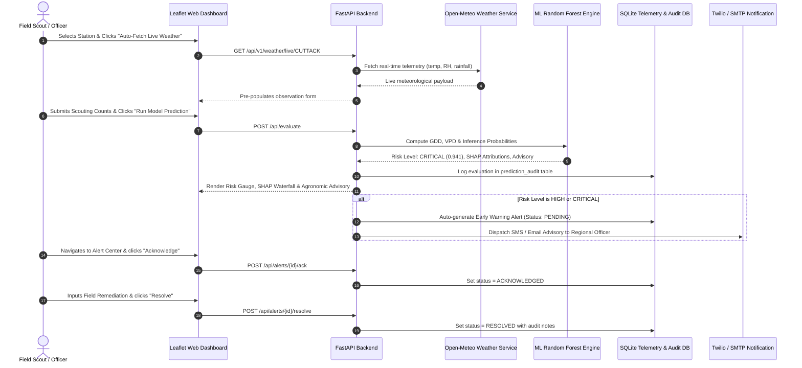

# 🔬 Scientific Architecture & Model Benchmark Evaluation

**Intelligent Pest Outbreak Prediction & Early Warning Framework**  
*ICAR & TNAU Bio-Climatic Micro-Surveillance Engine*

---

## 1. Bio-Climatic Mathematical Foundations

Pest population growth and insect lifecycle dynamics are governed by non-linear thermodynamic interactions between micro-climate and host-plant phenology. This framework models these dynamics through four primary physiological features:

### 1.1 Accumulated Growing Degree-Days (GDD)
Degree-days represent physiological heat accumulation above a biological developmental base temperature ($T_{\text{base}}$):

$$\text{GDD} = \max\left(0, \frac{T_{\max} + T_{\min}}{2} - T_{\text{base}}\right)$$

Empirical species-specific physiological thresholds parameterized in `src/config.py`:
- **Brown Planthopper (*Nilaparvata lugens*):** $T_{\text{base}} = 12.0^\circ\text{C}$
- **Yellow Stem Borer (*Scirpophaga incertulas*):** $T_{\text{base}} = 10.0^\circ\text{C}$
- **Leaf Folder (*Cnaphalocrocis medinalis*):** $T_{\text{base}} = 11.5^\circ\text{C}$
- **Gall Midge (*Orseolia oryzae*):** $T_{\text{base}} = 13.0^\circ\text{C}$
- **American Bollworm (*Helicoverpa armigera*):** $T_{\text{base}} = 10.5^\circ\text{C}$
- **Whitefly (*Bemisia tabaci*):** $T_{\text{base}} = 12.5^\circ\text{C}$

### 1.2 Vapor Pressure Deficit (VPD)
Atmospheric drying power and plant transpirational stress calculated using Tetens' equation for saturated vapor pressure $e_s(T)$:

$$e_s(T) = 0.61078 \times \exp\left(\frac{17.27 \times T}{T + 237.3}\right) \quad (\text{kPa})$$

Actual vapor pressure ($e_a$) derived from relative humidity:

$$e_a = e_s(T_{\text{mean}}) \times \frac{\text{RH}_{\text{mean}}}{100}$$

$$\text{VPD} = e_s(T_{\text{mean}}) - e_a \quad (\text{kPa})$$

*Agronomic Significance:* Low VPD ($<0.5\text{ kPa}$) with high relative humidity ($>85\%$) forms stagnant micro-climate conditions favorable for fungal sporulation and planthopper nymphal survival.

### 1.3 Economic Threshold Levels (ETL)
Field risk classification adheres to official ICAR and TNAU surveillance standards:
- **Brown Planthopper:** 5 to 10 hoppers per hill (vegetative), 20 hoppers per hill (panicle stage).
- **Yellow Stem Borer:** 10% dead hearts at vegetative stage, or 2% white ears at flowering.
- **American Bollworm:** 1 larva per meter row or 5% damaged square/boll count.
- **Whitefly:** 6 to 8 adults per leaf.

---

## 2. Model Evaluation & Benchmark Results

The machine learning pipeline evaluates candidate models on historical holdout partitions from ICAR surveillance records.

### 2.1 Multi-Model Performance Benchmark

| Candidate Model | Accuracy | ROC-AUC | PR-AUC | F1-Score | Status |
|---|---|---|---|---|---|
| **Random Forest (Optimized)** | **0.9859** | **0.9998** | **0.9994** | **0.9859** | **Production Champion** |
| LightGBM Classifier | 0.9851 | 0.9997 | 0.9993 | 0.9851 | Candidate |
| XGBoost Classifier | 0.9832 | 0.9994 | 0.9989 | 0.9832 | Candidate |
| Logistic Regression (Baseline) | 0.8407 | 0.9080 | 0.8932 | 0.8407 | Baseline |

### 2.2 Explainable AI (SHAP Global Feature Attributions)

The Random Forest champion model is explained using TreeSHAP (`shap.TreeExplainer`). Top global predictors of pest outbreak probability:

1. **Current Outbreak Severity Signal ($W_t$):** Leading indicator representing localized population exponential phase.
2. **Field Scout Population vs ETL Ratio:** Ratio of observed field density to economic injury threshold.
3. **Accumulated Degree-Days (GDD):** Cumulative physiological units driving developmental instar transitions.
4. **Morning Relative Humidity ($\text{RH}_{\text{morning}}$):** High humidity ($>88\%$) triggers egg hatch and nymphal emergence.
5. **Diurnal Temperature Range ($\Delta T = T_{\max} - T_{\min}$):** Moderate swings between day and night prevent thermal mortality.
6. **Standard Meteorological Week (SMW):** Cyclical seasonal timing encoded as $\sin(2\pi \cdot \text{SMW} / 52)$ and $\cos(2\pi \cdot \text{SMW} / 52)$.

---

## 3. Geographic Micro-Surveillance Network

The system covers 11 major ICAR research stations across India's primary agro-ecological zones:

| Station Code | Station Name | Agro-Ecological Region | Lat | Lon | Target Crop |
|---|---|---|---|---|---|
| `CUTTACK` | ICAR-NRRI Cuttack | Coastal Eastern Plains | 20.4625 | 85.8830 | Rice |
| `MARUTERU` | RARS Maruteru | Godavari Delta Alluvium | 16.6310 | 81.7370 | Rice |
| `LAM` | RARS Lam, Guntur | Krishna Agro-climatic Zone | 16.3500 | 80.4400 | Cotton / Chilli |
| `NAGPUR` | ICAR-CICR Nagpur | Central Vidarbha Black Soil | 21.1458 | 79.0882 | Cotton |
| `AKOLA` | Dr. PDKV Akola | Western Vidarbha Plain | 20.7002 | 77.0082 | Cotton / Pulses |
| `LUDHIANA` | PAU Ludhiana | Trans-Gangetic Plain | 30.9010 | 75.8573 | Rice / Wheat / Cotton |
| `RAIPUR` | IGKV Raipur | Eastern Plateau & Hills | 21.2514 | 81.6296 | Rice |
| `RAJENDRANAGAR` | ICAR-IIRR Hyderabad | Southern Telangana Plateau | 17.3190 | 78.4060 | Rice |
| `SIRSA` | CICR RS Sirsa | Semi-Arid Indo-Gangetic | 29.5349 | 75.0289 | Cotton |
| `PARBHANI` | VNMKV Parbhani | Marathwada Black Soil | 19.2608 | 76.7749 | Cotton / Sorghum |
| `PALAMPUR` | CSK HPKV Palampur | Western Himalayan Sub-Humid | 32.1109 | 76.5363 | Rice / Maize |

---

## 4. End-to-End Early Warning Workflow

